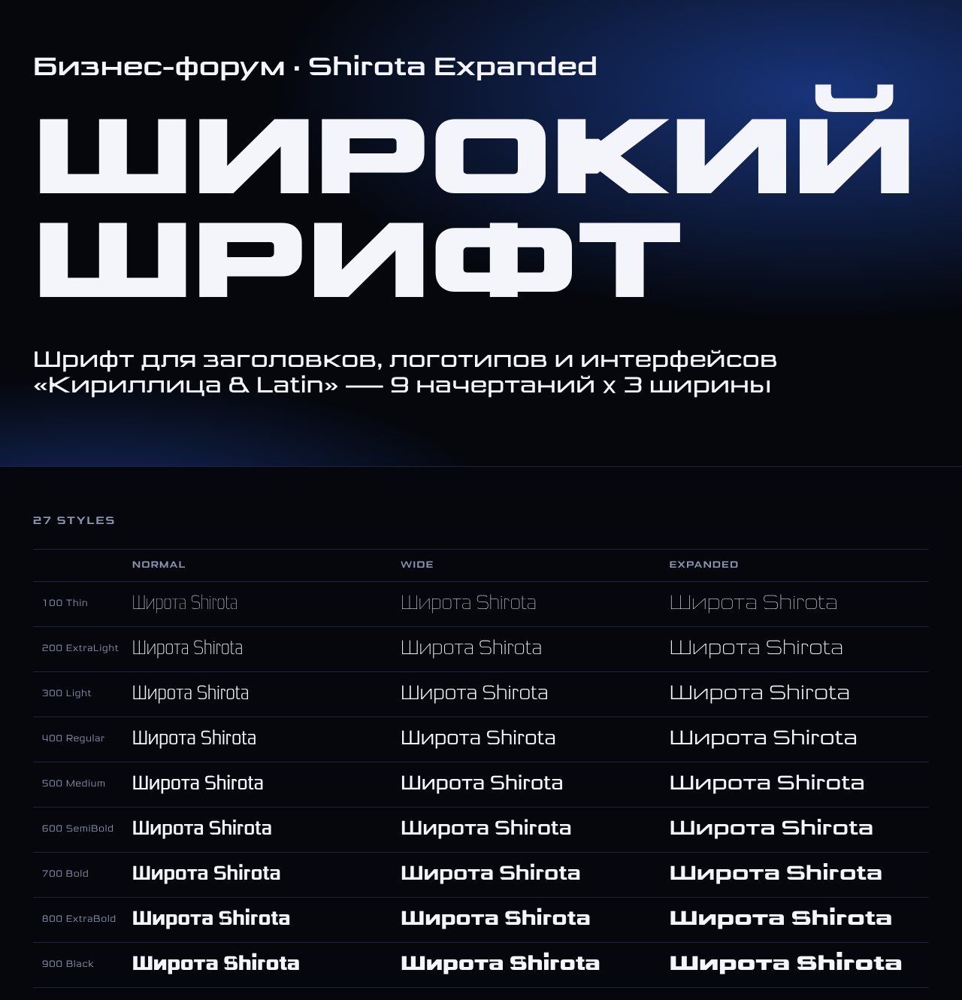

# Shirota

An extended, squarish grotesk drawn from scratch in the style of the reference
"Бизнес-форум МГУ" poster lettering. It has rounded corners on
the round letters (С, О, Р, Э …), sharp cuts on the straight ones (Е, Г, Ш, И …),
heavy verticals with lighter horizontals, and a large x-height.



## Styles

There are 27 static fonts: 9 weights in each of 3 widths.

| Weight | CSS | Normal (`Shirota`) | Wide (`Shirota Wide`) | Expanded (`Shirota Expanded`) |
|---|---|---|---|---|
| Thin | 100 | `Shirota-Thin` | `ShirotaWide-Thin` | `ShirotaExpanded-Thin` |
| ExtraLight | 200 | `Shirota-ExtraLight` | `ShirotaWide-ExtraLight` | `ShirotaExpanded-ExtraLight` |
| Light | 300 | `Shirota-Light` | `ShirotaWide-Light` | `ShirotaExpanded-Light` |
| Regular | 400 | `Shirota-Regular` | `ShirotaWide-Regular` | `ShirotaExpanded-Regular` |
| Medium | 500 | `Shirota-Medium` | `ShirotaWide-Medium` | `ShirotaExpanded-Medium` |
| SemiBold | 600 | `Shirota-SemiBold` | `ShirotaWide-SemiBold` | `ShirotaExpanded-SemiBold` |
| Bold | 700 | `Shirota-Bold` | `ShirotaWide-Bold` | `ShirotaExpanded-Bold` |
| ExtraBold | 800 | `Shirota-ExtraBold` | `ShirotaWide-ExtraBold` | `ShirotaExpanded-ExtraBold` |
| Black | 900 | `Shirota-Black` | `ShirotaWide-Black` | `ShirotaExpanded-Black` |

Each width suits a different job:

- **Normal** is for UI, body text and small sizes.
- **Wide** is for subheads, labels and buttons.
- **Expanded** is for headlines, posters and logos. Use **Expanded Black** to
  match the poster's big name headline, and Expanded Medium–Bold to match the
  lines under it.

## Character set

Each font has 406 glyphs:

- **Cyrillic:** the full Russian alphabet (А–Я, а–я, Ё ё), plus Ukrainian
  (Є І Ї Ґ), Belarusian (Ў) and Serbian/Macedonian (Ђ Ј Љ Њ Ћ Џ Ѓ Ќ Ѕ Ѐ Ѝ).
- **Latin:** A–Z and a–z, all of Latin-1 (À–ÿ, ß, Æ, Ø, Þ, Ð), and most of
  Latin Extended-A. That covers Polish, Czech, Slovak, Hungarian, Romanian,
  Turkish, Croatian and other European languages.
- **Figures:** tabular lining figures 0–9.
- **Punctuation:** including « » „ “ ” ‘ ’ – — … and №.
- **Symbols:** ₽ € £ ¥ ¢ $ % & @ © ® ™ ° § and the math signs.

Every font also has kerning: a GPOS `kern` feature generated for each style.

## Files

```
fonts/ttf/      27 hinted TrueType fonts (desktop apps, Figma, Office …)
fonts/woff2/    27 WOFF2 webfonts
css/shirota.css @font-face rules
specimen/       index.html — open it in a browser for a type tester and the full glyph set
source/         the generator (Python) that draws every glyph
```

## Using it on the web

```html
<link rel="stylesheet" href="design/fonts/shirota/css/shirota.css">
```

```css
.headline { font-family: "Shirota Expanded"; font-weight: 900; }
.subtitle { font-family: "Shirota Expanded"; font-weight: 500; }
.label    { font-family: "Shirota Wide";     font-weight: 600; }
.body     { font-family: "Shirota";          font-weight: 400; }

/* Or use one family and pick the width with font-stretch: 100% | 125% | 150% */
.alt { font-family: "Shirota Family"; font-stretch: 150%; font-weight: 800; }
```

On the desktop, install the `.ttf` files. Apps show three families,
`Shirota`, `Shirota Wide` and `Shirota Expanded`, each with nine weights.

## Rebuilding / changing the design

The fonts are fully parametric. Every glyph is built from stems, rounded rings,
"C" shapes and diagonals in `source/shirota/`. Each style is computed from two
inputs, the stem thickness of its weight and a width factor. Both live in
`source/shirota/params.py`.

```bash
cd source
pip install -r requirements.txt
python build_fonts.py                 # all 27 styles (~30 s)
python build_fonts.py --only Black:Expanded Regular:
```

Some things you can tune in `params.py`:

- Stem thickness per weight: `WEIGHTS`.
- Width factors: `WIDTHS`.
- Cap height and x-height: `CAP`, `XH`.
- Corner radius: `R`.
- How much thinner horizontals are than verticals: `H`.
- Spacing: `sb`.

The construction of each letter is in `caps.py`, `lower.py`, `figures.py`,
`punct.py` and `marks.py`. `registry.py` maps each glyph to its Unicode code
point.

## Not included yet

- **A variable font (one file with weight and width axes).** About two-thirds
  of the glyphs are already point-compatible across masters. The rest need
  their constructions adjusted before they can interpolate.
- **Italics.**
- **Bulgarian and Serbian alternate letterforms (`locl`).**
- **Superscripts, fractions and old-style figures.**
- **A license.** None has been chosen yet. Pick one, for example the SIL Open
  Font License, before you distribute the fonts.
